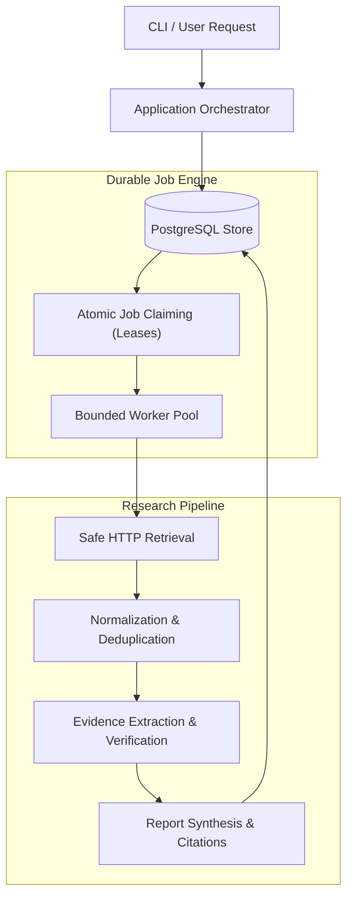

# NetForge — Architecture Direction

Source of truth: `docs/SPECIFICATION.md` (Sections 5 & 6).

---

## 1. System Mission
NetForge is a personal research companion delivering scheduled daily technical briefings and on-demand evidence-backed investigations. Its engineering foundation is a durable, observable, and fault-tolerant job execution engine.

---

## 2. Core Entities

### Job
The bounded unit of work.
- Stable unique identifier (`ID`).
- Associated request (`RunID`).
- Handler selector (`Type`).
- Input arguments (`Payload`).
- Lifecycle status (`State`).
- Metadata: `AttemptCount`, `LeaseExpiresAt`, `StartedAt`, `FinishedAt`, `LastError`, `ResultRef`.

### Run
A research request or scheduled briefing grouping related jobs (subtasks, fan-out/fan-in).

---

## 3. Core Invariants
1. **Durability First:** Persist a job before acknowledging acceptance.
2. **Mutual Exclusion:** Only one valid lease holder owns a job at a time.
3. **Lease Protection:** A worker must not overwrite state after its lease expires.
4. **Bounded Retries:** Exponential backoff with jitter based on error classification (retryable vs permanent).
5. **No Exactly-Once Illusion:** At-least-once execution with idempotency and deduplicated commits.
6. **Crash Recovery:** A process restart must not erase accepted work or leave abandoned jobs permanently locked.

